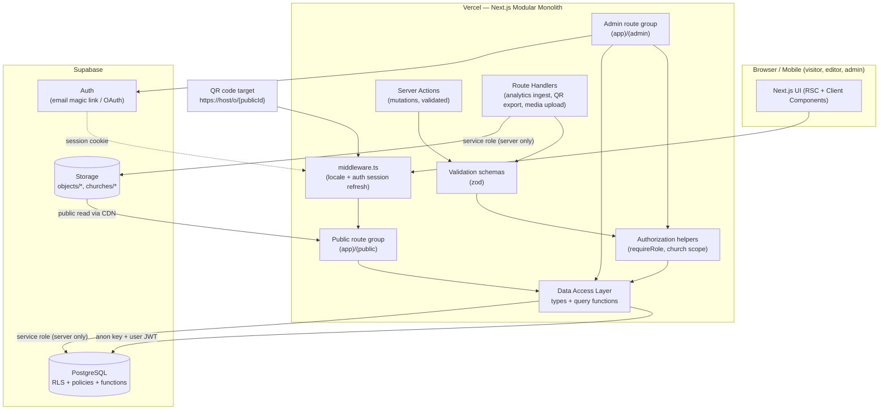

# System Architecture

> Document: `architecture.md`
> Status: Phase 1 — approved for implementation planning
> Related: [`requirements.md`](./requirements.md), [`database-schema.md`](./database-schema.md), [`security-and-permissions.md`](./security-and-permissions.md), [`api-contracts.md`](./api-contracts.md), [`implementation-roadmap.md`](./implementation-roadmap.md), [`architecture-decisions.md`](./architecture-decisions.md)

---

## 1. Architectural Style

A **modular monolith** deployed as a single Next.js application:

- One deployable unit (Next.js on Vercel).
- One managed PostgreSQL database (Supabase) with Row Level Security as the last line of defense.
- One managed object storage bucket set (Supabase Storage).
- Module boundaries expressed as folders, not network services.
- Server logic lives in server components, server actions, and route handlers; the browser
  receives only non-privileged data.

Rationale: the workload (read-heavy public pages, low-write admin workflows, thousands of
records) does not justify distributed complexity. See ADR-001 in `architecture-decisions.md`.

---

## 2. Component Diagram



**Trust boundary:** everything under `Vercel` is server-side except the code shipped to the
browser. The Supabase **service-role key is server-only** and is never exposed to the client.
The browser only ever holds the Supabase **anon key** and the user's session.

---

## 3. Next.js Routing Conventions

App Router (`app/`), TypeScript, React Server Components by default.

```
app/
  layout.tsx                     # root: html lang/dir driven by locale
  (public)/
    layout.tsx                   # public shell: header, language switch, footer
    page.tsx                     # landing page
    o/[publicId]/page.tsx        # THE QR TARGET (canonical object page)
    churches/[slug]/page.tsx     # optional church page (if enabled, Q4)
    about/page.tsx
    [not-found states]
  (admin)/
    layout.tsx                   # admin shell; requires authenticated session
    admin/
      page.tsx                   # dashboard
      objects/page.tsx           # list + filters
      objects/new/page.tsx
      objects/[id]/edit/page.tsx
      objects/[id]/review/page.tsx
      churches/page.tsx
      churches/[id]/page.tsx
      users/page.tsx
      analytics/page.tsx
  api/
    analytics/route.ts           # POST ingest (rate-limited)
    qr/[objectId]/route.ts       # GET QR PNG/SVG export
    media/upload/route.ts        # POST signed-upload orchestration
  auth/
    callback/route.ts            # Supabase auth callback
    signout/route.ts
middleware.ts                    # locale negotiation + session refresh
```

**Locale strategy:**

- Locale-prefixed routes: `/en/...`, `/ar/...`; `en` is the platform default.
- The **QR-encoded URL is language-independent**: `https://{host}/o/{publicId}`.
- `middleware.ts` handles `/o/{publicId}` by negotiating locale (cookie → `Accept-Language`
  → default) and rewriting/redirecting to `/{locale}/o/{publicId}` **without changing the token**.
- Root `/` redirects to the negotiated locale.

### 3.1 Route access groups

| Group | Auth | Who | Content |
| --- | --- | --- | --- |
| `(public)/*` | none | anyone | published content only |
| `(admin)/admin/*` | required | editors, reviewers, approvers, admins | drafts + review + config |
| `api/analytics` | none | anyone | write-only ingest |
| `api/qr/*` | required (admin) | editors+ | QR export |
| `api/media/upload` | required (editor+) | editors+ | signed upload |

---

## 4. Server vs Client Responsibilities

| Concern | Server (RSC / action / handler) | Client component |
| --- | --- | --- |
| Fetch public object content | ✅ from DB via DAL | — |
| Render object page | ✅ RSC | — |
| Language switch UI | — | ✅ toggles cookie / link |
| Auth session | ✅ middleware refresh, server checks | — |
| Draft editing forms | — | ✅ form UI |
| Persist edits | ✅ server action + validation + authz | — |
| Review decisions | ✅ server action + authz | ✅ confirm UI |
| Upload media | ✅ sign upload, then verify | ✅ direct-to-storage (signed) |
| Analytics ingest | ✅ route handler | ✅ fire-and-forget beacon |
| QR export | ✅ route handler | ✅ trigger/download |

Rule: **the client never determines authorization**. Client components may hide controls for UX
only; every mutation is re-checked server-side and again by RLS in the database.

---

## 5. Data Access Patterns

A single **Data Access Layer (DAL)** module centralizes queries. Two clients:

1. **User-scoped client** — uses anon key + forwarded user session (cookies). Subject to RLS.
   Used for all admin reads/writes and for public reads (RLS allows anonymous read of published
   rows).
2. **Admin/service client** — uses the service-role key, used *only* server-side for operations
   that must bypass RLS in a controlled way (e.g. writing analytics, generating signed upload
   URLs, cross-church admin operations). Wrapped and never imported into client bundles.

DAL conventions:

- Functions are typed and return domain objects, not raw rows.
- Public read functions run through the user-scoped client so RLS is always exercised; a
  `createServiceClient()` path is only used where explicitly documented.
- Caching: public reads use `unstable_cache` / Next fetch cache with tags
  (`object:{publicId}`, `church:{slug}`). Mutations call `revalidateTag` after commit
  (`cache-invalidation` on publish/unpublish/archive/edit).
- No raw SQL string interpolation; use the Supabase query builder / parameterized RPC.

### 5.1 Validation

- All external input validated with **zod** schemas colocated in `lib/validation/`.
- Server actions re-validate; never trust client-supplied IDs (derive church scope from
  membership, not from the form).
- File uploads validated for MIME sniffing, extension, and size on the server before finalize.

### 5.2 Error handling

- Server actions return a discriminated result type `{ ok: true, data } | { ok: false, error }`;
  no thrown errors leak internal detail to the client.
- Route handlers return a consistent JSON error envelope (see `api-contracts.md §8`).
- Errors are logged with a correlation id; user-facing messages are generic.

### 5.3 Loading and not-found states

- `loading.tsx` skeletons for admin lists and object page.
- `not-found.tsx` for unknown `publicId` → 404.
- Archived objects → 410 page with a neutral explanation (no content).
- Missing translation → still 200, default-language content + fallback notice.

---

## 6. Environment Configuration and Secrets

| Variable | Scope | Exposure |
| --- | --- | --- |
| `NEXT_PUBLIC_SUPABASE_URL` | app | public |
| `NEXT_PUBLIC_SUPABASE_ANON_KEY` | app | public |
| `SUPABASE_SERVICE_ROLE_KEY` | server | **secret** |
| `ANALYTICS_HASH_SALT` | server | **secret**, rotatable |
| `SUPABASE_JWT_SECRET` (if needed for verification) | server | **secret** |
| `NEXT_PUBLIC_SITE_URL` | app | public |

- Validated at boot with a zod env schema; the app refuses to start if required vars are missing.
- Secrets set in Vercel project settings and local `.env.local` (git-ignored).
- No secret is ever imported in a `"use client"` module or prefixed `NEXT_PUBLIC_`.

---

## 7. Request Lifecycle A — Visitor Scans a QR Code

```mermaid
sequenceDiagram
  autonumber
  participant V as Visitor phone
  participant MW as Next middleware
  participant RSC as Object RSC (app/(public)/o/[publicId])
  participant DAL as DAL (user-scoped)
  participant DB as Postgres (RLS)
  participant CDN as Image CDN / Storage

  V->>MW: GET /o/7Q2M4XR9KD
  MW->>MW: negotiate locale (cookie → Accept-Language → en)
  MW-->>V: 308 → /en/o/7Q2M4XR9KD (token unchanged)
  V->>RSC: GET /en/o/7Q2M4XR9KD
  RSC->>RSC: validate publicId format (Crockford Base32, len 10)
  RSC->>DAL: getPublishedObject(publicId, locale)
  DAL->>DB: select object + translations + media + claims (anon role)
  DB-->>DAL: rows filtered by RLS: status='published' AND church active
  alt not found / not published
    DB-->>DAL: empty
    DAL-->>RSC: null
    RSC-->>V: 404 (not found)
  else archived
    RSC-->>V: 410 Gone (neutral page)
  else found
    RSC->>RSC: pick locale translation; fallback to default if missing
    RSC-->>V: streamed HTML (cacheable, ISR/revalidate tag)
    V->>CDN: load responsive images (public, long cache)
    V->>RSC: optional POST /api/analytics (page_view, locale)
  end
```

Key points: the token is never rewritten; RLS guarantees only published rows are readable;
locale fallback is a rendering concern; analytics is fire-and-forget and non-blocking.

---

## 8. Request Lifecycle B — Editor Creates, Reviews, and Publishes an Object

```mermaid
sequenceDiagram
  autonumber
  participant E as Editor (browser)
  participant ADM as Admin RSC
  participant SA as Server Action
  participant VAL as zod
  participant AZ as authz helper
  participant DAL as DAL
  participant DB as Postgres (RLS)
  participant R as Reviewer
  participant C as Church approver

  Note over E,DB: Create
  E->>ADM: open /admin/objects/new
  ADM->>AZ: requireMember(['editor'])
  ADM-->>E: form (churches = my memberships)
  E->>SA: createObject(input)
  SA->>VAL: parse input
  SA->>AZ: requireChurchRole(churchId, 'editor')
  AZ-->>SA: ok (membership verified)
  SA->>DAL: insert object (status='draft') + public_id generated
  DAL->>DB: insert (RLS: editor of church only)
  DB-->>SA: row
  SA-->>E: ok, redirect to edit

  Note over E,DB: Submit for review
  E->>SA: submitForReview(objectId)
  SA->>AZ: requireChurchRole(church, 'editor')
  SA->>DAL: transition draft→historical_review
  DAL->>DB: update status; insert publication_history (RLS: must be draft owner-church)
  DB-->>SA: ok

  Note over R,DB: Historical review
  R->>SA: reviewHistorical(objectId, decision, notes)
  SA->>AZ: requireChurchRole(church, 'historical_reviewer')
  SA->>DAL: insert review_records + transition
  DAL->>DB: church_review (approve) or draft (reject)
  DB-->>R: updated queue

  Note over C,DB: Church approval & publish
  C->>SA: decideChurchApproval(objectId, decision, notes)
  SA->>AZ: requireChurchRole(church, 'church_approver')
  SA->>DAL: insert review_records; on approve set published + published_at
  DAL->>DB: RLS permits church_review→published only for approver
  DB-->>SA: ok
  SA->>DAL: revalidateTag('object:{publicId}')
  SA-->>C: published; public URL live
```

Database-level guarantee: the transition `church_review → published` is only permitted by RLS
when the actor has the `church_approver` role for that church, regardless of any application bug.
See `security-and-permissions.md §4`.

---

## 9. Caching and Invalidation

- Public object pages: cached at the edge/CDN with tag `object:{publicId}`; revalidated on any
  publish/unpublish/archive/media change.
- Church pages: tag `church:{slug}`.
- Admin pages: `dynamic` / no-store (always fresh).
- Static assets and images: immutable, long max-age, content-hashed.
- Analytics writes never invalidate content caches.

---

## 10. Deployment Topology

- **Hosting:** Vercel (or compatible Node runtime) — Next.js build, edge middleware, ISR/CDN.
- **Database:** Supabase Postgres (managed). Migrations versioned in `supabase/migrations/`.
- **Storage:** Supabase Storage buckets — `object-media` (public-read, CDN) and `incoming`
  (private staging for uploads before validation). Bucket policies documented in
  `security-and-permissions.md §6`.
- **Environments:** local → preview (per PR) → production. Each non-prod environment uses a
  separate Supabase project or schema. No production data in previews.
- **CI/CD:** GitHub Actions runs lint, typecheck, unit tests; DB migrations checked with a
  shadow database; E2E on preview deploy.

### 10.1 Cost trigger notes

Free tiers are expected to suffice for the pilot. Costs begin on: storage egress for large
image libraries, database size beyond free tier, Vercel bandwidth beyond hobby limits. These are
monitored; no paid resource is provisioned in Phase 1.

---

## 11. Risks and Mitigations

| Risk | Impact | Mitigation |
| --- | --- | --- |
| Unapproved content leaking publicly | High trust damage | RLS + status-gated public queries; tests asserting drafts are unreachable |
| publicId collision or reuse | Broken QR codes | Cryptographically random generation + unique constraint + never reuse archived IDs |
| Arabic RTL layout regressions | Poor UX for primary audience | Logical CSS properties, RTL visual tests in E2E |
| Large images on slow connections | Slow LCP | Server-side variants, responsive `srcset`, lazy loading |
| Service-role key leakage | Full DB compromise | Server-only usage, lint rule banning import in client modules, no `NEXT_PUBLIC_` |
| Orphaned media / storage growth | Cost, clutter | Media tied to object lifecycle; cleanup job on archive |
| Single-region outage | Downtime | Managed Supabase backups + PITR; static public shell on CDN |

---

## 12. Cross-References

- Tables and RLS: `database-schema.md`, `security-and-permissions.md`.
- Endpoints and server actions: `api-contracts.md`.
- Sequencing and definitions of done: `implementation-roadmap.md`.
- Decisions and alternatives: `architecture-decisions.md`.
