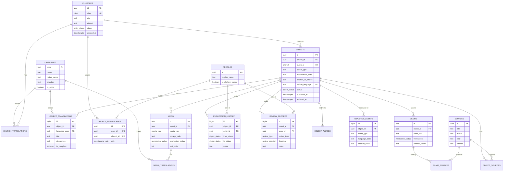

# Database Schema

> Document: `database-schema.md`
> Database: Supabase PostgreSQL (managed), accessed via PostgREST + Row Level Security
> Status: Phase 1 — approved for implementation planning
> Related: [`requirements.md`](./requirements.md), [`architecture.md`](./architecture.md), [`security-and-permissions.md`](./security-and-permissions.md), [`api-contracts.md`](./api-contracts.md)

---

## 1. Conventions

- **Engine:** PostgreSQL 15+ (Supabase).
- **Primary keys:** `uuid` with `default gen_random_uuid()` for entity tables.
  Append-only high-volume tables (`analytics_events`, `publication_history`, `review_records`)
  use `bigint generated always as identity` as PK for compactness and ordering.
- **Timestamps:** `timestamptz` (UTC) with `default now()`. Mutable rows carry `updated_at`
  maintained by a trigger.
- **Naming:** `snake_case`, plural table names, singular enum type names.
- **Soft delete / archival:** status columns + `archived_at`; hard deletes are avoided except
  for media cleanup and analytics retention.
- **Text lengths:** enforced with `varchar(n)` on user-facing fields; `text` for long content.
- **RLS:** enabled on every table; no table is readable by `anon` unless it holds public data.
  Policy details live in `security-and-permissions.md`.
- **Extensions:** `pgcrypto` (gen_random_uuid), `pg_trgm` (search on titles), `citext` (slugs).
- **`auth.users`** is managed by Supabase Auth and referenced, never modified directly.

---

## 2. Entity-Relationship Diagram

---

## 3. Enum Types

| Enum | Values | Notes |
| --- | --- | --- |
| `object_status` | `draft`, `historical_review`, `church_review`, `published`, `archived` | Object workflow state (FR-PB-1). Used only by `objects`. |
| `entity_status` | `active`, `archived` | For churches and any entity needing simple active/archive. |
| `media_type` | `image`, `audio` | |
| `permission_status` | `granted`, `public_domain`, `pending`, `restricted` | Publication gate for media (FR-MD-4). |
| `verification_status` | `verified`, `uncertain`, `disputed` | Per-claim (FR-OB-5). |
| `membership_role` | `editor`, `historical_reviewer`, `church_approver` | Church-scoped roles. Platform admin is a profile flag, not a membership. |
| `review_type` | `historical_review`, `church_approval` | |
| `review_decision` | `approved`, `rejected`, `changes_requested` | |
| `analytics_event_type` | `page_view`, `language_select`, `audio_play`, `audio_complete` | |

---

## 4. Tables

### 4.1 `languages`

**Purpose:** Registry of supported languages so new languages require data, not schema change
(FR-ML-2).

| Column | Type | Null | Default | Constraints |
| --- | --- | --- | --- | --- |
| `code` | `text` | no | — | PK; BCP-47 short code (`en`, `ar`, `cop`, …) |
| `name` | `text` | no | — | English name |
| `native_name` | `text` | no | — | e.g. `العربية` |
| `direction` | `text` | no | `ltr` | `check (direction in ('ltr','rtl'))` |
| `is_active` | `boolean` | no | `true` | Only active languages are selectable/translatable |
| `created_at` | `timestamptz` | no | `now()` | |

Seed rows: `en` (ltr, active), `ar` (rtl, active). Index: `unique(code)` via PK.

### 4.2 `churches`

**Purpose:** Church registry (FR-CH-*).

| Column | Type | Null | Default | Constraints |
| --- | --- | --- | --- | --- |
| `id` | `uuid` | no | `gen_random_uuid()` | PK |
| `slug` | `citext` | no | — | unique, `^[a-z0-9-]{3,60}$` |
| `status` | `entity_status` | no | `active` | |
| `city` | `text` | yes | — | |
| `district` | `text` | yes | — | e.g. Cairo district / governorate |
| `latitude` | `numeric(9,6)` | yes | — | optional, church-level only |
| `longitude` | `numeric(9,6)` | yes | — | optional |
| `dedication_date` | `text` | yes | — | free text / approximate |
| `rite` | `text` | yes | `coptic_orthodox` | |
| `cover_media_id` | `uuid` | yes | — | FK → `media.id` (deferred; nullable) |
| `metadata` | `jsonb` | no | `'{}'` | extensible, non-critical fields |
| `created_at` | `timestamptz` | no | `now()` | |
| `updated_at` | `timestamptz` | no | `now()` | trigger-maintained |

Indexes: unique `slug`; `status`. Relationships: 1 church → many objects, many memberships,
many translations.

> Design choice: church **content** is localized via `church_translations` (§4.3) rather than
> duplicate name/description columns, keeping the multilingual model uniform.

### 4.3 `church_translations`

**Purpose:** Localized church name/description (FR-ML-1/4).

| Column | Type | Null | Default | Constraints |
| --- | --- | --- | --- | --- |
| `id` | `bigint` | no | identity | PK |
| `church_id` | `uuid` | no | — | FK → `churches.id` `on delete cascade` |
| `language_code` | `text` | no | — | FK → `languages.code` |
| `name` | `text` | no | — | |
| `description` | `text` | yes | — | |
| `created_at` | `timestamptz` | no | `now()` | |
| `updated_at` | `timestamptz` | no | `now()` | |

Unique: `(church_id, language_code)`. Index: `church_id`.

### 4.4 `profiles`

**Purpose:** Application profile for each authenticated user; global admin flag.

| Column | Type | Null | Default | Constraints |
| --- | --- | --- | --- | --- |
| `id` | `uuid` | no | — | PK, FK → `auth.users.id` `on delete cascade` |
| `display_name` | `text` | no | — | |
| `is_platform_admin` | `boolean` | no | `false` | Global override role |
| `created_at` | `timestamptz` | no | `now()` | |
| `updated_at` | `timestamptz` | no | `now()` | |

Index: `is_platform_admin` (partial, where true). Populated by a trigger on `auth.users`
insert. Never stores passwords or tokens.

### 4.5 `church_memberships`

**Purpose:** Church-scoped role assignments; a user may hold multiple roles across churches
(FR-PB-2…, requirements §3.6).

| Column | Type | Null | Default | Constraints |
| --- | --- | --- | --- | --- |
| `id` | `uuid` | no | `gen_random_uuid()` | PK |
| `user_id` | `uuid` | no | — | FK → `profiles.id` `on delete cascade` |
| `church_id` | `uuid` | no | — | FK → `churches.id` `on delete cascade` |
| `role` | `membership_role` | no | — | |
| `created_at` | `timestamptz` | no | `now()` | |
| `created_by` | `uuid` | yes | — | FK → `profiles.id` |

Unique: `(user_id, church_id, role)`. Indexes: `user_id`, `church_id`, `(church_id, role)`.
A user may have several roles in one church and roles in several churches.

### 4.6 `objects`

**Purpose:** Core heritage object records (FR-OB-*).

| Column | Type | Null | Default | Constraints |
| --- | --- | --- | --- | --- |
| `id` | `uuid` | no | `gen_random_uuid()` | PK |
| `church_id` | `uuid` | no | — | FK → `churches.id` `on delete restrict` |
| `public_id` | `char(10)` | no | — | unique; `^[0-9A-HJKMNP-TV-Z]{10}$` (Crockford Base32) |
| `object_type` | `text` | no | — | controlled vocabulary (see 4.6.1) |
| `approximate_date` | `text` | yes | — | free text ("18th c.", "c. 1250") |
| `location_in_church` | `text` | yes | — | e.g. "north wall, nave" |
| `default_language` | `text` | no | `en` | FK → `languages.code` |
| `status` | `object_status` | no | `draft` | |
| `materials` | `text` | yes | — | |
| `dimensions` | `text` | yes | — | |
| `condition_notes` | `text` | yes | — | internal |
| `published_at` | `timestamptz` | yes | — | set on first publish |
| `archived_at` | `timestamptz` | yes | — | set when archived |
| `archive_reason` | `text` | yes | — | |
| `created_by` | `uuid` | yes | — | FK → `profiles.id` |
| `created_at` | `timestamptz` | no | `now()` | |
| `updated_at` | `timestamptz` | no | `now()` | trigger |

Indexes: unique `public_id`; `church_id`; `status`; composite `(status, church_id)`;
GIN trigram on translations title (see 4.7). Relationships: 1 object → many translations,
media, claims, history rows.

Constraints:
- `published_at is null or status in ('published','archived')`.
- `archived_at is null or status = 'archived'`.

#### 4.6.1 Object-type vocabulary

Stored as `text` with a `check` initially; may later become a lookup table:

`icon`, `wall_painting`, `fresco`, `architectural_feature`, `wood_carving`, `iconostasis`,
`inscription`, `manuscript`, `liturgical_object`, `other`.

### 4.7 `object_translations`

**Purpose:** Localized object content; one row per language (FR-ML-4/5/6).

| Column | Type | Null | Default | Constraints |
| --- | --- | --- | --- | --- |
| `id` | `bigint` | no | identity | PK |
| `object_id` | `uuid` | no | — | FK → `objects.id` `on delete cascade` |
| `language_code` | `text` | no | — | FK → `languages.code` |
| `title` | `text` | no | — | |
| `description` | `text` | yes | — | |
| `is_complete` | `boolean` | no | `false` | editorial flag for completeness tracking |
| `created_at` | `timestamptz` | no | `now()` | |
| `updated_at` | `timestamptz` | no | `now()` | |

Unique: `(object_id, language_code)`. Index: `object_id`; GIN trigram on `title` for internal
search. **Completeness tracking:** presence of a row + `is_complete` determines whether a
language is "available" vs "complete". A view `object_translation_status` (object_id,
language_code, has_row, is_complete) supports the dashboard (FR-ML-7).

### 4.8 `claims`

**Purpose:** Atomic, individually-verifiable assertions about an object; separates verified from
uncertain/disputed information (FR-OB-5, HR-3).

| Column | Type | Null | Default | Constraints |
| --- | --- | --- | --- | --- |
| `id` | `uuid` | no | `gen_random_uuid()` | PK |
| `object_id` | `uuid` | no | — | FK → `objects.id` `on delete cascade` |
| `claim_text` | `text` | no | — | the assertion ("The icon dates to the 18th century") |
| `claimed_value` | `text` | yes | — | optional structured short value ("18th century") |
| `verification` | `verification_status` | no | `uncertain` | |
| `is_public` | `boolean` | no | `true` | allow internal-only claims |
| `sort_order` | `integer` | no | `0` | |
| `created_by` | `uuid` | yes | — | FK → `profiles.id` |
| `created_at` | `timestamptz` | no | `now()` | |
| `updated_at` | `timestamptz` | no | `now()` | |

Indexes: `object_id`; `(object_id, is_public)`. Relationship: many-to-many with `sources` via
`claim_sources`.

**Rationale for claim-level sources:** a single object may have several contested attributes
(date, attribution, provenance) each supported by different evidence. Associating sources at the
object level alone cannot represent which citation supports which claim. Hence sources attach to
claims (primary) *and* optionally to the object as a whole (4.11). See ADR-005.

### 4.9 `sources`

**Purpose:** Bibliographic references (FR-OB-4).

| Column | Type | Null | Default | Constraints |
| --- | --- | --- | --- | --- |
| `id` | `uuid` | no | `gen_random_uuid()` | PK |
| `title` | `text` | no | — | |
| `author` | `text` | yes | — | |
| `year` | `text` | yes | — | free text (approximate allowed) |
| `citation` | `text` | yes | — | full formatted citation |
| `url` | `text` | yes | — | |
| `source_type` | `text` | yes | — | `book`, `article`, `archive`, `oral`, `web`, `other` |
| `created_by` | `uuid` | yes | — | FK → `profiles.id` |
| `created_at` | `timestamptz` | no | `now()` | |
| `updated_at` | `timestamptz` | no | `now()` | |

Index: trigram on `title`.

### 4.10 `claim_sources` (join)

**Purpose:** Many-to-many claim↔source (FR-OB-5).

| Column | Type | Null | Default | Constraints |
| --- | --- | --- | --- | --- |
| `claim_id` | `uuid` | no | — | FK → `claims.id` `on delete cascade` |
| `source_id` | `uuid` | no | — | FK → `sources.id` `on delete cascade` |
| `note` | `text` | yes | — | which page/section supports the claim |
| `created_at` | `timestamptz` | no | `now()` | |

PK: `(claim_id, source_id)`.

### 4.11 `object_sources` (join)

**Purpose:** Many-to-many object↔source for object-wide (not claim-specific) references.

| Column | Type | Null | Default | Constraints |
| --- | --- | --- | --- | --- |
| `object_id` | `uuid` | no | — | FK → `objects.id` `on delete cascade` |
| `source_id` | `uuid` | no | — | FK → `sources.id` `on delete cascade` |
| `note` | `text` | yes | — | |
| `created_at` | `timestamptz` | no | `now()` | |

PK: `(object_id, source_id)`.

### 4.12 `media`

**Purpose:** Media metadata, separate from object records (FR-MD-2).

| Column | Type | Null | Default | Constraints |
| --- | --- | --- | --- | --- |
| `id` | `uuid` | no | `gen_random_uuid()` | PK |
| `object_id` | `uuid` | no | — | FK → `objects.id` `on delete cascade` |
| `media_type` | `media_type` | no | — | |
| `storage_path` | `text` | no | — | path within bucket |
| `bucket` | `text` | no | `object-media` | |
| `mime_type` | `text` | no | — | server-validated |
| `size_bytes` | `bigint` | no | — | |
| `width` | `integer` | yes | — | images |
| `height` | `integer` | yes | — | images |
| `duration_seconds` | `numeric(7,2)` | yes | — | audio |
| `checksum` | `text` | yes | — | sha256 for integrity/dedup |
| `copyright_holder` | `text` | yes | — | |
| `attribution` | `text` | yes | — | required display string |
| `permission_status` | `permission_status` | no | `pending` | publication gate |
| `is_public` | `boolean` | no | `false` | explicit publish flag |
| `sort_order` | `integer` | no | `0` | |
| `created_by` | `uuid` | yes | — | FK → `profiles.id` |
| `created_at` | `timestamptz` | no | `now()` | |
| `updated_at` | `timestamptz` | no | `now()` | |

Indexes: `object_id`; `(object_id, sort_order)`; `permission_status`. Check:
`media_type='audio' → bucket='object-media'`; images/audio size limits enforced at ingest.

### 4.13 `media_translations`

**Purpose:** Localized caption + alt text per media item (FR-MD-3).

| Column | Type | Null | Default | Constraints |
| --- | --- | --- | --- | --- |
| `id` | `bigint` | no | identity | PK |
| `media_id` | `uuid` | no | — | FK → `media.id` `on delete cascade` |
| `language_code` | `text` | no | — | FK → `languages.code` |
| `caption` | `text` | yes | — | |
| `alt_text` | `text` | yes | — | required for public images (app-enforced) |
| `created_at` | `timestamptz` | no | `now()` | |
| `updated_at` | `timestamptz` | no | `now()` | |

Unique: `(media_id, language_code)`.

### 4.14 `review_records`

**Purpose:** Immutable audit of review decisions (FR-PB-7, HR-2/HR-4, CA-*).

| Column | Type | Null | Default | Constraints |
| --- | --- | --- | --- | --- |
| `id` | `bigint` | no | identity | PK |
| `object_id` | `uuid` | no | — | FK → `objects.id` `on delete cascade` |
| `actor_id` | `uuid` | no | — | FK → `profiles.id` `on delete restrict` |
| `review_type` | `review_type` | no | — | |
| `decision` | `review_decision` | no | — | |
| `notes` | `text` | yes | — | required when rejected/changes_requested (app-enforced) |
| `created_at` | `timestamptz` | no | `now()` | |

Indexes: `object_id`; `(object_id, created_at desc)`. **Append-only:** no UPDATE/DELETE policy
for non-admins; even admins only read. Written only by the transition function.

### 4.15 `publication_history`

**Purpose:** Immutable audit of every status transition (FR-PB-6).

| Column | Type | Null | Default | Constraints |
| --- | --- | --- | --- | --- |
| `id` | `bigint` | no | identity | PK |
| `object_id` | `uuid` | no | — | FK → `objects.id` `on delete cascade` |
| `actor_id` | `uuid` | yes | — | FK → `profiles.id`; null for system transitions |
| `from_status` | `object_status` | yes | — | null on creation |
| `to_status` | `object_status` | no | — | |
| `notes` | `text` | yes | — | |
| `created_at` | `timestamptz` | no | `now()` | |

Indexes: `object_id`; `(object_id, created_at desc)`; `created_at`. Append-only.

### 4.16 `object_aliases`

**Purpose:** Preserve QR URLs for renamed/relocated objects; retire old IDs permanently
(FR-QR-4/6).

| Column | Type | Null | Default | Constraints |
| --- | --- | --- | --- | --- |
| `alias` | `char(10)` | no | — | PK; a retired/alternate public ID |
| `object_id` | `uuid` | no | — | FK → `objects.id` `on delete restrict` |
| `created_at` | `timestamptz` | no | `now()` | |

Aliases are never reassigned to a different object. A lookup in the public page resolves
`objects.public_id` first, then `object_aliases.alias` → target object.

### 4.17 `analytics_events`

**Purpose:** Privacy-conscious raw events (FR-AN-1…8).

| Column | Type | Null | Default | Constraints |
| --- | --- | --- | --- | --- |
| `id` | `bigint` | no | identity | PK |
| `event_type` | `analytics_event_type` | no | — | |
| `object_id` | `uuid` | yes | — | FK → `objects.id` `on delete set null` |
| `church_id` | `uuid` | yes | — | FK → `churches.id` `on delete set null` |
| `language_code` | `text` | yes | — | FK → `languages.code` |
| `session_hash` | `text` | yes | — | salted, rotating, non-reversible |
| `referrer_type` | `text` | yes | — | coarse: `qr`, `direct`, `internal`, `external` |
| `occurred_at` | `timestamptz` | no | `now()` | |

Indexes: `(occurred_at)`; `(object_id, occurred_at)`; `(church_id, occurred_at)`. **No** IP,
user agent string, or precise location is stored. Raw rows purged after 90 days by scheduled
job. A daily aggregate view/materialized table `analytics_daily` stores durable rollups.

### 4.18 `analytics_daily` (aggregate)

| Column | Type | Null | Default | Constraints |
| --- | --- | --- | --- | --- |
| `day` | `date` | no | — | |
| `object_id` | `uuid` | yes | — | |
| `church_id` | `uuid` | yes | — | |
| `language_code` | `text` | yes | — | |
| `event_type` | `analytics_event_type` | no | — | |
| `count` | `integer` | no | `0` | |

PK: `(day, object_id, church_id, language_code, event_type)` (null-safe via `coalesce` keys in
practice; column set is fixed). Retained indefinitely.

---

## 5. Relationships Summary

| Relationship | Cardinality | Mechanism |
| --- | --- | --- |
| Church → Objects | 1:N | `objects.church_id` (restrict delete) |
| Church → Memberships | 1:N | `church_memberships.church_id` |
| Object → Translations | 1:N | unique `(object_id, language_code)` |
| Object → Media | 1:N | `media.object_id` |
| Media → Media translations | 1:N | unique `(media_id, language_code)` |
| Object → Claims | 1:N | `claims.object_id` |
| Claim ↔ Source | M:N | `claim_sources` |
| Object ↔ Source | M:N | `object_sources` |
| User ↔ Church (role) | M:N | `church_memberships` |
| Object → Review records | 1:N | append-only |
| Object → Publication history | 1:N | append-only |
| Object → Aliases | 1:N | retired IDs |
| Object → Analytics events | 1:N | `on delete set null` |

---

## 6. Data Integrity Rules

1. **No public exposure of unpublished data:** RLS policies restrict `anon` reads to
   `objects.status='published'` joined to `churches.status='active'`, and only public media
   (`is_public and permission_status in ('granted','public_domain')`).
2. **Delete semantics:**
   - Archiving a church sets its objects to `archived` (application transaction) and hides them;
     rows are preserved.
   - `objects.church_id` uses `on delete restrict` so a church with objects cannot be hard-deleted.
   - Deleting an object cascades translations, media rows, claims, joins, and audit rows; storage
     objects are cleaned by a job. Hard delete is admin-only and audit-logged.
3. **public_id integrity:** unique constraint; generation retries on collision; archived IDs
   moved to `object_aliases`; IDs never reused.
4. **Workflow integrity:** a `SECURITY DEFINER` function `transition_object_status()` is the only
   sanctioned writer of `objects.status`; it enforces the allowed transition matrix and required
   role, and writes `publication_history`. Direct status updates are blocked by RLS.
5. **Review immutability:** `review_records` and `publication_history` have no UPDATE/DELETE
   policies.
6. **Translation completeness:** derived from `object_translations` rows + `is_complete`, exposed
   via `object_translation_status` view.
7. **Media publication gate:** `media.is_public = true` requires
   `permission_status in ('granted','public_domain')` (check constraint + app rule).

---

## 7. Indexing Strategy

- All foreign keys indexed.
- Public hot path: `objects(public_id)` unique; `objects(status, church_id)`.
- Admin queues: `objects(church_id, status)`; `review_records(object_id, created_at desc)`.
- Search (internal): GIN trigram on `object_translations.title` and `sources.title`.
- Analytics: time-ordered `(occurred_at)` plus `(object_id, occurred_at)`.
- No indexes on `analytics_events.session_hash` beyond coarse use to limit cost.

---

## 8. Migration Strategy

- All schema changes via versioned SQL in `supabase/migrations/` (`NNNN_description.sql`).
- RLS policies and functions live in migrations, reviewed like code.
- Seed data (`languages`, object types) via idempotent seed migration.
- Migrations tested against a shadow DB in CI before merge.
- Roll-forward only; destructive changes require a documented two-step migration.

---

## 9. Open Questions Affecting Schema

- **Q1 (domain/subdomain):** no schema impact.
- **Q2 (non-public media):** if required, add `media.access_scope` enum and storage RLS with
  signed URLs. Media table already carries `is_public`; extension is additive.
- **Q6 (admin publish override):** `transition_object_status()` would need an explicit
  `platform_admin` bypass branch (audited). Currently *not* included.
