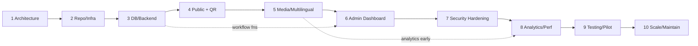

# Implementation Roadmap

> Document: `implementation-roadmap.md`
> Status: Phase 1 — approved for implementation planning
> Related: [`requirements.md`](./requirements.md), [`architecture.md`](./architecture.md), [`database-schema.md`](./database-schema.md), [`security-and-permissions.md`](./security-and-permissions.md), [`api-contracts.md`](./api-contracts.md), [`architecture-decisions.md`](./architecture-decisions.md)

Each phase is independently testable and produces a working increment. A phase is complete only
when its **Definition of Done** is met, including its tests.

---

## Phase 1 — Requirements and Architecture (this phase)

- **Dependencies:** none.
- **Tasks:** produce the seven architecture documents; resolve or record open questions Q1–Q7.
- **Deliverables:** `requirements.md`, `architecture.md`, `database-schema.md`,
  `security-and-permissions.md`, `api-contracts.md`, `implementation-roadmap.md`,
  `architecture-decisions.md`.
- **Acceptance criteria:** documents are internally consistent; every FR has a home; the schema
  and RLS strategy are unambiguous; a future agent can start Phase 2 without inventing structure.
- **Tests:** none (documentation); review for consistency.
- **Definition of done:** all seven files exist in `docs/architecture/`; cross-references resolve;
  open questions listed with owners/required decisions.

---

## Phase 2 — Repository and Development Infrastructure

- **Dependencies:** Phase 1.
- **Tasks:**
  - Initialize Next.js (App Router) + TypeScript project; enable strict mode.
  - Add Tailwind CSS; configure RTL-aware base styles and font loading (Arabic + Latin).
  - Establish folder structure (`app/`, `components/`, `lib/{db,validation,authz,actions}/`,
    `types/`, `supabase/migrations`, `tests/`).
  - Configure ESLint, Prettier, `tsc --noEmit`, Husky/lint-staged.
  - Add Vitest (unit) and Playwright (E2E) skeletons.
  - Add `.env.example` and a zod-validated env module; `.gitignore` for secrets.
  - GitHub Actions CI: install, lint, typecheck, unit tests.
  - README with setup instructions.
- **Deliverables:** buildable, testable skeleton; CI green.
- **Acceptance criteria:** `next dev` runs; sample page renders; CI passes on a fresh clone;
  env validation refuses to start with missing vars.
- **Tests:** one smoke unit test; one Playwright smoke E2E; CI executes both.
- **Definition of done:** PR merged with green CI; documented local setup verified.
- **Parallelizable:** Tailwind/RTL setup ∥ CI setup ∥ testing skeleton (after project init).

---

## Phase 3 — Database and Backend Foundation

- **Dependencies:** Phase 2; **schema frozen** from `database-schema.md`.
- **Tasks:**
  - Write Supabase migrations: enums, tables, constraints, indexes, triggers (`updated_at`,
    profile creation).
  - Add `SECURITY DEFINER` helper functions and the `transition_object_status()` function.
  - Write RLS policies per `security-and-permissions.md`.
  - Seed `languages` and object-type vocabulary.
  - Implement DAL and typed clients (user-scoped + server-only service client).
  - Implement zod validation schemas and `ActionResult` plumbing.
  - Set up a shadow DB for migration testing in CI.
- **Deliverables:** complete schema with RLS; DAL queries; migration test suite.
- **Acceptance criteria:** migrations apply cleanly to a fresh DB; RLS denies anon draft reads;
  transition function rejects illegal transitions and wrong roles; all FR-PB and FR-ML storage
  requirements satisfied.
- **Tests:** pgTAP or SQL tests for RLS/transition rules; unit tests for DAL mapping and zod
  schemas.
- **Definition of done:** schema + policies reviewed; RLS tests green; no table lacks RLS.
- **Must wait for:** Phase 1 schema decisions (Q2, Q6 materially affect policies/storage).

---

## Phase 4 — Public Website and QR Routing

- **Dependencies:** Phase 3.
- **Tasks:**
  - Locale middleware: `/o/{publicId}` → locale negotiation (token unchanged).
  - Public object page (`/en|ar/o/[publicId]`) with RSC data fetch via gated DAL.
  - Language switch; RTL layout for Arabic; translation fallback notice.
  - Render translations, public claims (with verification indicator), public media.
  - 404 vs 410 handling; archived neutral page.
  - Caching with tags + `revalidateTag` wired to future publish actions.
  - Accessibility pass and mobile layout.
- **Deliverables:** the QR-scan experience end to end.
- **Acceptance criteria:** scanning a QR URL (test public id) renders published content in both
  languages; drafts are unreachable; LCP budget met in Lighthouse (throttled); axe shows no
  critical issues.
- **Tests:** E2E for `/o/{id}` in `en`/`ar`, fallback, 404, 410; unit tests for locale
  negotiation; RTL visual snapshot.
- **Definition of done:** public pages pass E2E + a11y + performance gates on preview deploy.
- **Parallelizable:** a11y/performance work ∥ content rendering (after page skeleton).

---

## Phase 5 — Media and Multilingual Support

- **Dependencies:** Phase 4.
- **Tasks:**
  - Signed upload flow (`incoming` → validate → promote to `object-media`).
  - Image variant generation; audio metadata; checksums.
  - Media captions/alt text per language; attribution/permission UI.
  - Media publication gate (`is_public` rules).
  - Translation completeness dashboard view.
  - Responsive image delivery on public pages.
- **Deliverables:** full media pipeline; complete multilingual editing.
- **Acceptance criteria:** invalid MIME/size rejected server-side; only public+permitted media
  appear publicly; alt text enforced for public images; translations never overwrite.
- **Tests:** upload validation unit tests; E2E upload + render; storage policy tests.
- **Definition of done:** media + translations requirements (FR-MD-*, FR-ML-*) verified by tests.

---

## Phase 6 — Administrative Dashboard

- **Dependencies:** Phase 5 (and Phase 3 workflow functions).
- **Tasks:**
  - Auth (magic link) + protected admin shell; role-aware navigation.
  - Object CRUD, translation/claim/source editing.
  - Review queues: historical review and church approval, with notes.
  - Publish/unpublish/archive actions wired to `transition_object_status` + cache revalidation.
  - Church management and user/membership management (admin).
  - QR generation/export (`/api/qr/[objectId]`).
  - Media manager UI.
- **Deliverables:** complete editorial workflow UI.
- **Acceptance criteria:** each role sees only permitted queues/actions; an editor cannot publish;
  reviewer/approver gates enforced; every transition appears in `publication_history`; QR export
  encodes the permanent URL.
- **Tests:** E2E for the full Draft→Review→Approval→Published path per role; negative tests for
  forbidden actions (403); transition-function tests already in Phase 3.
- **Definition of done:** end-to-end publish journey passes with each role; audit rows verified.
- **Parallelizable:** object editor ∥ review queues ∥ church/user admin (after auth shell).

---

## Phase 7 — Security Hardening

- **Dependencies:** Phase 6.
- **Tasks:**
  - RLS policy review against the permission matrix; add missing negative tests.
  - Rate limiting for analytics and upload signing.
  - Secret-scanning + lint rule banning service-role import in client modules.
  - CSP/security headers; cookie flags; CSRF-safe server actions.
  - Auth session edge cases (expiry, no-role users, sign-out).
  - Optional `admin_audit_log` for membership/delete events.
  - Penetration-style review of publication bypass paths.
- **Deliverables:** hardened security posture; test evidence.
- **Acceptance criteria:** no path allows unapproved publication; no secret in client bundle;
  rate limits verified; security headers present.
- **Tests:** adversarial E2E (attempt publish as editor, anon draft read, cross-church edit);
  dependency audit.
- **Definition of done:** all security tests green; findings triaged and addressed.

---

## Phase 8 — Analytics, Monitoring, Performance

- **Dependencies:** Phase 7 (analytics exists earlier; this hardens it).
- **Tasks:**
  - Privacy-conscious analytics ingest + retention job (≤90 days raw) + daily aggregates.
  - Admin analytics views (per object/church/language/day).
  - Error and performance monitoring (provider TBD; must not collect PII).
  - Cache/ISR tuning; image optimization review; Core Web Vitals budget enforcement.
- **Deliverables:** analytics pipeline + dashboards; monitoring; performance report.
- **Acceptance criteria:** events recorded without PII; raw purge works; aggregate accuracy
  verified; Core Web Vitals within budget.
- **Tests:** analytics unit/integration tests; retention job test; performance regression test.
- **Definition of done:** analytics + monitoring live in non-prod; privacy review signed off.

---

## Phase 9 — Testing, Pilot Deployment

- **Dependencies:** Phases 3–8.
- **Tasks:**
  - Complete E2E coverage of critical journeys; accessibility audit; RTL audit.
  - Backup/restore drill; incident runbook; deployment runbook.
  - Provision production Supabase + Vercel; configure secrets; run migrations.
  - Pilot with one church: onboard, load a small object set, print a QR, validate real scans.
- **Deliverables:** production environment; pilot content; operational docs.
- **Acceptance criteria:** real QR scan works on real devices; content correct in both languages;
  restore drill succeeds within RTO; pilot church approves usability.
- **Tests:** full regression E2E; restore drill; load test on public pages.
- **Definition of done:** pilot church live; runbooks validated; go/no-go review passed.

---

## Phase 10 — Scaling and Long-Term Maintenance

- **Dependencies:** Phase 9.
- **Tasks:**
  - Onboard additional churches; bulk import tooling; batch QR generation.
  - Review indexes/query plans at scale; add search if needed.
  - Cost/usage monitoring; alerting thresholds.
  - Maintenance cadence: dependency updates, migration hygiene, backup audits.
  - Revisit open questions (Q1–Q7) and ADRs.
- **Deliverables:** scale-ready operations; maintenance plan.
- **Acceptance criteria:** performance holds at projected volume; costs within budget; documented
  ownership.
- **Tests:** load tests at projected volume; migration/rollback rehearsal.
- **Definition of done:** scale checklist complete; maintenance owners assigned.

---

## Dependency and Parallelization Summary

- **Hard dependencies:** each phase requires the previous for its core deliverable.
- **Safe parallelization within a phase:** noted per phase; across phases, only the dashed
  early-start links are advisable and must not change frozen contracts (schema, public URL, RLS).
- **Must wait for decisions:** Phase 3 policies depend on Q2 (non-public media) and Q6 (admin
  publish override); Phase 4 depends on Q4 (browse directory).

---

## Recommended Starting Task for Phase 2

**`[Phase 2 / Task 1] Initialize the Next.js + TypeScript + Tailwind repository skeleton`**

Concretely, the next agent should:

1. Scaffold a Next.js App Router project with TypeScript (strict) and Tailwind CSS.
2. Create the folder structure from `architecture.md §3` and `§12` (empty route groups,
   `lib/{db,validation,authz,actions}`, `types`, `supabase/migrations`, `tests`).
3. Add `.env.example`, a zod-validated `lib/env.ts`, and `.gitignore` entries for `.env*.local`.
4. Configure ESLint, Prettier, Vitest, and Playwright; add a smoke test for each.
5. Add a GitHub Actions workflow running `lint`, `typecheck`, and unit tests.
6. Update `README.md` with local setup steps.

No database, Supabase project, or deployment is created in Phase 2. See `architecture.md §12`
for the intended directory structure.
